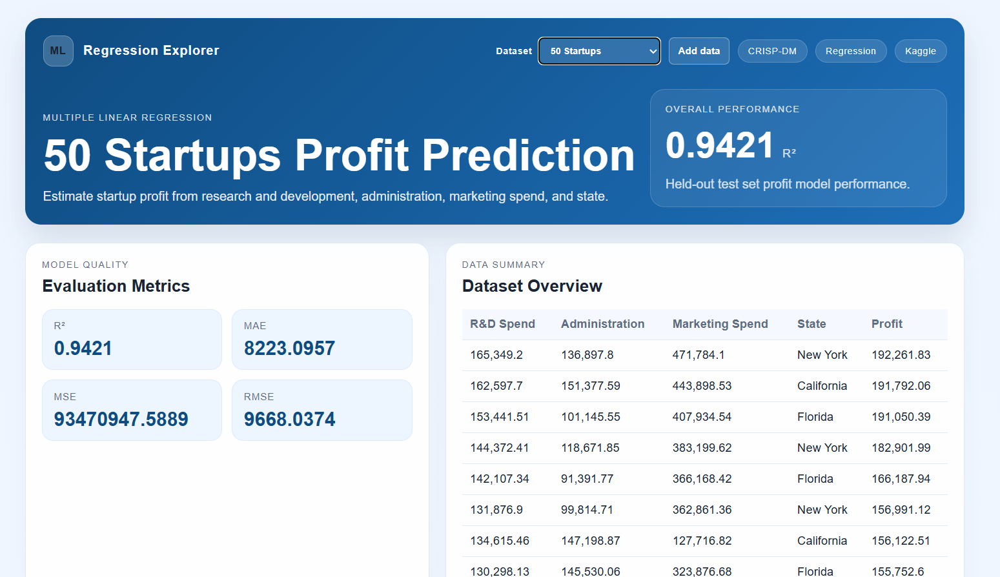

# 50 Startups Multiple Linear Regression

https://stevenwujr.github.io/101450startup/



A small interactive web demo for comparing multiple linear regression on 50 Startups and Boston Housing.

## Project goal
This project applies the CRISP-DM workflow to the Kaggle 50 Startups dataset and predicts the `Profit` value using the following inputs:

- R&D Spend
- Administration
- Marketing Spend
- State

## Model
The web demo uses a seeded 80/20 train-test split and ordinary least squares. The 50 Startups model one-hot encodes `State` with California as the reference. Boston Housing uses its 13 numeric predictors and predicts `MEDV`, measured in thousands of US dollars. The feature explorer compares Lasso ranking, forward selection, RFE, ElasticNet ranking, and exhaustive subsets from one to five predictors.

## Files

- `index.html` — main page
- `styles.css` — styling
- `app.js` — regression logic and dashboard rendering
- `50_Startups.csv` — dataset
- `BostonHousing.csv` — Boston Housing dataset (506 rows, 13 predictors, and `medv` target)
- `dataset-config.js` — dataset metadata and shared CSV/feature preparation
- `dataset-import.js` — CSV upload, schema validation, and browser-local persistence
- `feature-selection.js` — interactive feature-selection analysis
- `vercel.json` — Vercel static deployment config

## Local preview
Open the project in a browser via a local server:

```bash
python -m http.server 8000
```

Then visit:

```text
http://localhost:8000/
```

## Vercel deployment
This project is static and can be deployed directly to Vercel.

1. Push the project to GitHub.
2. Open Vercel.
3. Import the repository.
4. Use the default static site settings.
5. Deploy.

## Metrics displayed
The page shows:

- R-squared (R²)
- Mean Absolute Error (MAE)
- Mean Squared Error (MSE)
- Root Mean Squared Error (RMSE)

## Importing data

Use **Add data** in the dashboard navigation to either add a CSV as a new dataset or append rows to the currently selected dataset. New datasets require choosing a numeric target column; numeric and low-cardinality categorical predictors are inferred automatically. Keep the expanded predictor count at 13 or fewer, provide complete rows, and use at least five records per category. Constant predictor columns are ignored.

CSV files can be up to 1.5 MB. Appended CSVs must contain the selected dataset's target and predictor columns; header matching ignores capitalization and surrounding spaces. Imported datasets and appended rows are stored in this browser's local storage and are not uploaded to a server. Browser storage limits apply.

## Boston Housing data note

`BostonHousing.csv` is the Boston Housing data mirrored by [selva86/datasets](https://github.com/selva86/datasets/blob/master/BostonHousing.csv). Its `MEDV` target is capped at $50,000, and its `B` predictor is derived from a racially discriminatory census measure. This historical dataset is for education and should not be used for real housing decisions.

## Notes
The project is intended for learning and demonstration purposes, especially for showing how multiple linear regression works on a real-world business dataset.
